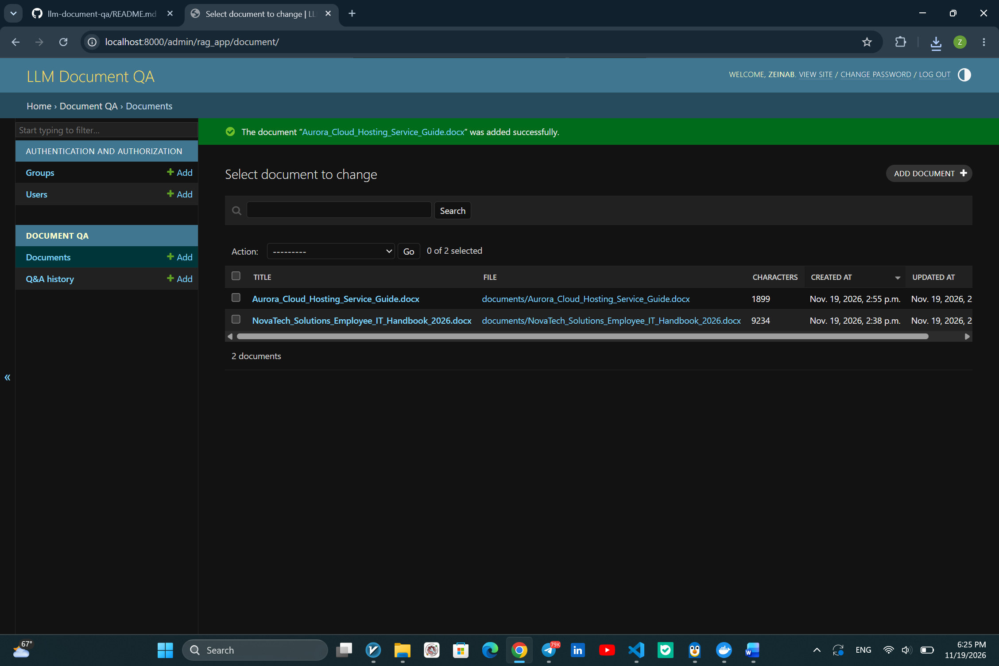
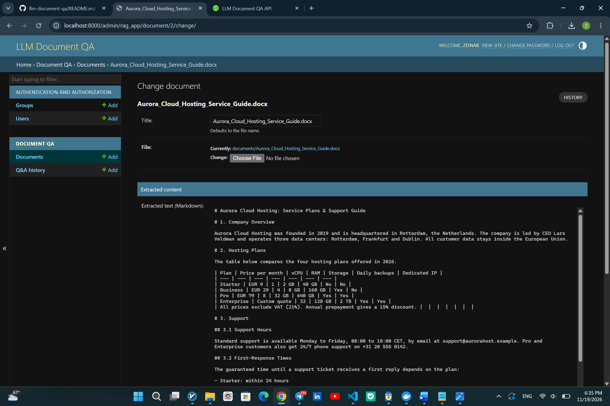
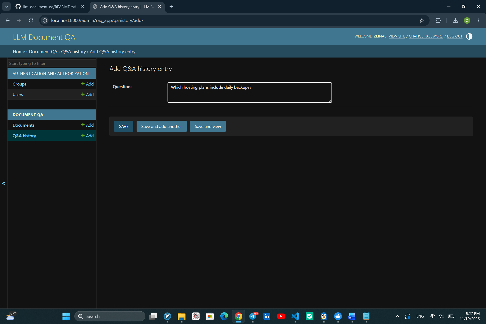
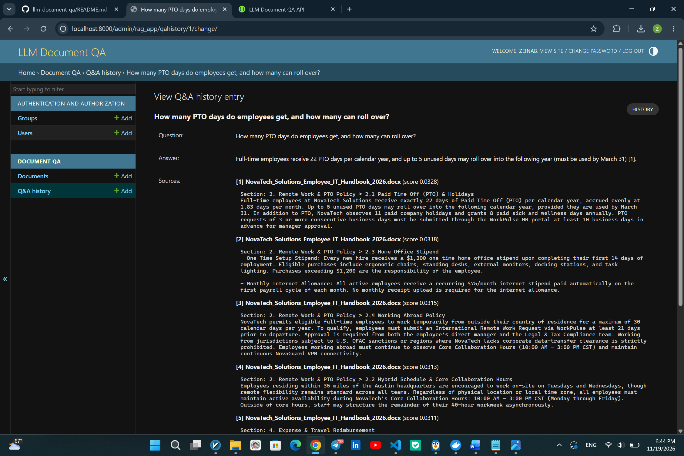
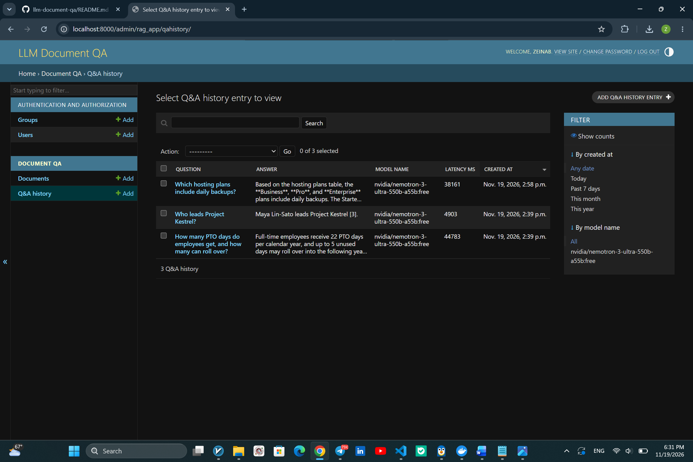
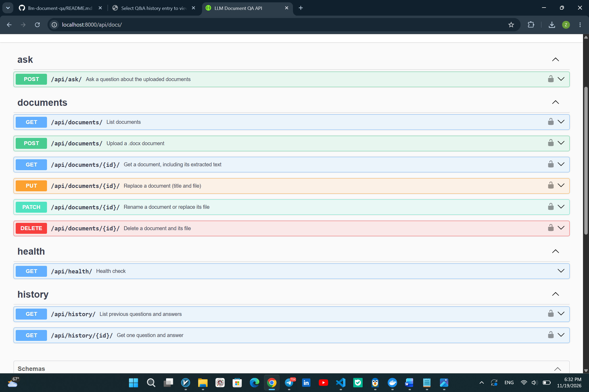

# LLM Document QA

Upload Word (`.docx`) documents and ask questions about them. Answers are generated by an LLM **only from the content of the uploaded documents**, with numbered citations pointing to the exact passages used. If the documents don't contain the answer, the system says so instead of guessing.

Built with **Django**, **Django REST Framework**, **LangChain**, local **sentence-transformers** embeddings, and a free LLM via **OpenRouter**. The UI is the Django Admin; everything is also available through a documented REST API.

---

## Features

| Requirement | How it is met |
|---|---|
| Add / edit / delete documents | Admin + `GET/POST/PATCH/PUT/DELETE /api/documents/`. Replacing a file re-extracts its text; deleting removes the file from disk. |
| `.docx` support | `python-docx`, converted to Markdown so headings, lists and tables survive. |
| Store full extracted text | `Document.extracted_text`, visible in the admin and `GET /api/documents/{id}/`. |
| Submit a question | Admin ("Q&A history → Add") or `POST /api/ask/`. |
| Find relevant content | Section-aware chunking + hybrid search. |
| Advanced retrieval | **Hybrid retrieval**: semantic embedding search + BM25 keyword search, merged with **Reciprocal Rank Fusion**. |
| Grounded answer | Strict prompt: answer only from the numbered passages, cite them as `[1]`, otherwise return a fixed fallback sentence. |
| Q&A history | `QAHistory` stores question, answer, the source passages, model name and latency. Admin + `GET /api/history/`. |

Also included: duplicate-upload detection, input validation with clear errors, authentication, rate limiting on the LLM endpoint, OpenAPI/Swagger docs, a health check, a terminal `ask` command, 57 automated tests, and a Docker setup that works offline after build.

> **Reviewer quick path**
> 1. **Run it:** [Quick start (Docker)](#quick-start-docker), about 3 commands.
> 2. **See it:** [Screenshots](#screenshots) of the admin and the API, no setup needed.
> 3. **Understand it:** [Architecture](#architecture) and [Key technical decisions](#key-technical-decisions) below.
> 4. **Use the API:** Swagger at `/api/docs/`, reference in [docs/API.md](docs/API.md).
> 5. **Try sample questions:** [test_documents/QUESTIONS.md](test_documents/QUESTIONS.md). Day-to-day commands: [HOW_TO_USE.md](HOW_TO_USE.md).

---

## Quick start (Docker)

Requirements: Docker with Compose, and a free OpenRouter API key from <https://openrouter.ai/keys>.

```bash
cp .env.example .env
# Edit .env: set OPENROUTER_API_KEY, DJANGO_SECRET_KEY and DJANGO_SUPERUSER_PASSWORD

docker compose up --build
```

The first build takes a few minutes (it downloads PyTorch CPU and the embedding model). Then open:

| URL | What |
|---|---|
| <http://localhost:8000/admin/> | Admin UI. Log in with `DJANGO_SUPERUSER_USERNAME` / `DJANGO_SUPERUSER_PASSWORD` from `.env`. |
| <http://localhost:8000/api/docs/> | Interactive API docs (Swagger UI) |
| <http://localhost:8000/api/redoc/> | API reference (ReDoc) |

With `LOAD_SAMPLE_DATA=1` (the default in `.env.example`) the sample handbook from `sample_data/` is uploaded on startup, so you can ask questions immediately.

> The first question after startup is slow (about 45 s in Docker on a laptop): the embedding model is loaded and the search index is built once, then reused. Later questions take about 5 s.

> **Docker Hub blocked on your network** (`403 Forbidden` while pulling `python`)? Add `PYTHON_IMAGE=public.ecr.aws/docker/library/python:3.11-slim` to `.env`. It is the same official image, served from Amazon's registry.

Useful commands: `docker compose up -d` (run in background), `docker compose logs -f`, `docker compose exec web python manage.py ask` (ask from the terminal), `docker compose down` (stop; data is kept in a volume; add `-v` to wipe it).

## Local development (without Docker)

Requires Python 3.11+.

```bash
python -m venv venv
venv\Scripts\activate            # Windows  (Linux/macOS: source venv/bin/activate)
pip install -r requirements.txt

cp .env.example .env             # set OPENROUTER_API_KEY; keep DJANGO_DEBUG=1
python manage.py migrate
python manage.py createsuperuser
python manage.py load_sample_data   # optional
python manage.py runserver
```

Run the tests (they use a fake LLM and fake embeddings, so they run offline in ~15 s):

```bash
python manage.py test rag_app
```

---

## Using it

### In the admin

1. **Documents → Add**: choose a `.docx` file (title is optional). The text is extracted immediately; open the document to see the extracted Markdown.
2. **Q&A history → Add**: type a question and save. The answer, its cited sources and the response time are stored and shown.

### From the terminal

```bash
python manage.py ask "How many PTO days do employees get?"   # one question
python manage.py ask                                         # interactive: keep asking
```

Answers are printed with their numbered sources and saved to the Q&A history. No server or login needed.

### Through the API

All endpoints except `/api/health/` and the docs require authentication (HTTP Basic or the admin session).

```bash
# Upload
curl -u admin:PASSWORD -F "file=@sample_data/NovaTech_Solutions_Employee_IT_Handbook_2026.docx" \
     http://localhost:8000/api/documents/

# Ask
curl -u admin:PASSWORD -H "Content-Type: application/json" \
     -d '{"question": "How many PTO days do employees get?"}' \
     http://localhost:8000/api/ask/
```

```json
{
  "id": 1,
  "question": "How many PTO days do employees get?",
  "answer": "Full-time employees receive 22 PTO days per calendar year, and up to 5 unused days may roll over into the following year (must be used by March 31) [1].",
  "sources": [
    {
      "number": 1,
      "document_id": 1,
      "document_title": "NovaTech_Solutions_Employee_IT_Handbook_2026.docx",
      "section": "2. Remote Work & PTO Policy > 2.1 Paid Time Off (PTO) & Holidays",
      "excerpt": "Section: 2. Remote Work & PTO Policy > 2.1 Paid Time Off (PTO) & Holidays\nFull-time employees ...",
      "score": 0.0328,
      "vector_rank": 1,
      "keyword_rank": 1
    }
  ],
  "model_name": "nvidia/nemotron-3-ultra-550b-a55b:free",
  "latency_ms": 2783,
  "created_at": "2026-11-19T14:33:08Z"
}
```

Full endpoint reference with all request/response formats and error codes: **[docs/API.md](docs/API.md)**.

### Sample questions for the sample handbook

- How many PTO days do employees get, and how many can roll over?
- Who is the lead engineer of Project Kestrel and when does it launch?
- What should I do if my laptop is stolen? *(answer comes from a highlighted callout box)*
- What is the international meal per diem? *(answer comes from a table)*
- What is the capital of France? *(not in the document → fallback answer)*

---

## Architecture

```
                   ┌───────────────┐     ┌──────────────────────┐
  Admin UI ───────►│  forms.py     │     │                      │
                   │  admin.py     ├────►│                      │
  REST API ───────►│  serializers  │     │    services.py       │──► Document, QAHistory
  (DRF)            │  views.py     │     │  (business logic)    │    (SQLite)
                   └───────────────┘     │                      │
  manage.py ─────────────────────────────►                      │
  load_sample_data                       └──────────┬───────────┘
                                                    │ uses
                          ┌─────────────────────────▼─────────────────────────┐
                          │ rag/  (pure Python + LangChain, no Django imports)│
                          │  extract.py   .docx  → Markdown                    │
                          │  chunking.py  Markdown → section-aware chunks      │
                          │  index.py     HybridIndex (embeddings + BM25, RRF) │
                          │  qa.py        prompt | LLM | parser  (LCEL chain)  │
                          └────────────────────────────────────────────────────┘
```

**Upload** (synchronous, milliseconds): file → validate size → extract Markdown → reject if unreadable/empty → hash the text → reject duplicates → save.

**Question**:
1. `DocumentIndex.get()` runs one aggregate query (`COUNT`, `MAX(updated_at)`). If documents changed since the last build, it rebuilds the in-memory index; otherwise it reuses it.
2. `HybridIndex.search()` takes the top 20 semantic matches and the top 20 BM25 matches, fuses them with RRF, and keeps the best 5.
3. The 5 passages are numbered and sent to the LLM with a strict prompt.
4. The answer, sources, model and latency are saved to `QAHistory`.

### Key technical decisions

| Decision | Why | Trade-off |
|---|---|---|
| Extract text at upload, reject bad files | A `Document` row always contains valid text; errors are shown to the user immediately. | Upload request does parsing work (fast for `.docx`). |
| `.docx` → Markdown with heading detection by style **or** bold numbered lines | Real documents (including the sample) often fake headings with bold text. Section titles make every chunk self-explanatory. | Heuristic: a short, fully-bold line is treated as a heading. |
| Chunks ~800 chars, tables split by row with header repeated | Fits the embedding model's 256-token window; table rows keep their column meaning. | Fixed size is not tuned per document. |
| Hybrid retrieval (embeddings + BM25 + RRF) | Embeddings handle paraphrases; BM25 handles exact names, codes and emails. RRF merges rankings without comparing incompatible scores. | Two indexes to keep in sync (both rebuilt together). |
| Local embeddings (`all-MiniLM-L6-v2`) | Free, private (documents never leave the server for indexing), fast on CPU. | English-focused; larger models are more accurate. |
| In-memory index, rebuilt when documents change | Simple, exact, no extra services. Rebuild is cheap for document sets of this size. | Doesn't scale to very large corpora and is per process. Next step: pgvector / a vector DB and incremental updates. |
| Strict prompt + fixed fallback sentence + numbered citations | Prevents answers from outside knowledge; citations make answers verifiable. | Free models occasionally cite imperfectly. |
| SQLite in a Docker volume | Zero setup, enough for a single-instance app. | Swap for PostgreSQL for multi-instance deployments (one setting). |
| One gunicorn worker, 4 threads | One copy of the model + index in memory; threads cover concurrent LLM waits. | Horizontal scaling would need a shared vector store. |


---

## Configuration

All settings come from environment variables (see [.env.example](.env.example)):

| Variable | Default | Purpose |
|---|---|---|
| `OPENROUTER_API_KEY` | – (required) | OpenRouter key |
| `OPENROUTER_MODEL` | `nvidia/nemotron-3-ultra-550b-a55b:free` | Any model from the free collection |
| `DJANGO_SECRET_KEY` | – (required unless DEBUG) | Django signing key |
| `DJANGO_DEBUG` | `0` | Debug mode (compose forces `0`) |
| `DJANGO_ALLOWED_HOSTS` | `localhost,127.0.0.1` | Comma-separated host names |
| `EMBEDDING_MODEL` | `sentence-transformers/all-MiniLM-L6-v2` | HuggingFace embedding model |
| `CHUNK_SIZE` / `CHUNK_OVERLAP` | `800` / `100` | Chunking, in characters |
| `RETRIEVAL_TOP_K` | `5` | Passages sent to the LLM |
| `LLM_TEMPERATURE` / `LLM_TIMEOUT_SECONDS` | `0.1` / `60` | LLM call settings |
| `MAX_UPLOAD_SIZE_MB` | `10` | Upload limit |
| `ASK_RATE_LIMIT` | `20/min` | Per-user limit on `/api/ask/` |

## Project layout

```
core/                   Django project: settings (env-driven), root URLs
rag_app/
  models.py             Document, QAHistory
  services.py           upload validation, index lifecycle, answer + save
  serializers.py        API input/output
  views.py, urls.py     REST endpoints + OpenAPI docs
  admin.py, forms.py    Admin UI (incl. "ask a question" form)
  signals.py            delete files from disk with their documents
  rag/                  extraction, chunking, hybrid index, prompt/LLM chain
  management/commands/  load_sample_data, ask (ask questions from the terminal)
  tests/                57 tests (offline)
docker/entrypoint.sh    migrate, create admin, load sample data, start server
sample_data/            sample .docx for testing
docs/                   API reference, screenshots
```

## Screenshots

**Documents**: upload, list and character counts.



**Extracted text**: each document is converted to Markdown (headings, lists, tables).



**Ask a question** from the admin.



**The answer** with numbered sources, so every claim can be checked.



**History**: every question, answer, model and response time.



**REST API** documentation (Swagger UI at `/api/docs/`).



## Limitations and next steps

- **Scale**: the index lives in memory and is rebuilt when any document changes. For large corpora: persist embeddings (pgvector) and update incrementally.
- **Formats**: only `.docx`. Images, headers/footers, footnotes and text boxes are ignored. Adding PDF would only need a new extractor; chunking and retrieval are format-agnostic.
- **Reranking**: a cross-encoder reranker on the fused top-20 would further improve precision, at extra CPU cost.
- **Async processing**: very large uploads could move extraction/indexing to a background worker (Celery/RQ).
- **Evaluation**: a small labelled question set would let retrieval settings be tuned with numbers instead of judgement.
